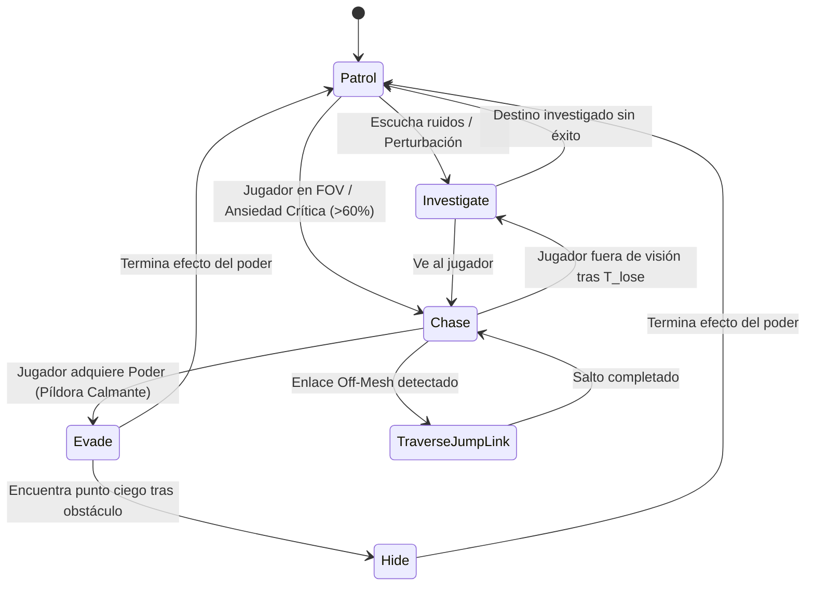

# Proyecto Final: Terror Psicológico Procedural - Fase 2
## Inteligencia Artificial, Steering Behaviors, Física Predictiva y Navegación Autónoma

[](https://unity.com/)
[](#)
[](#)
[](#)

---

## 📌 Tabla de Contenidos
1. [Descripción General](#-descripción-general)
2. [Pilar 1: Técnicas de Steering (Steering Behaviors)](#-pilar-1-técnicas-de-steering-steering-behaviors)
3. [Pilar 2: Física Predictiva y Balística Aerodinámica](#-pilar-2-física-predictiva-y-balística-aerodinámica)
4. [Pilar 3: Waypoints y Rutas Discretizadas](#-pilar-3-waypoints-y-rutas-discretizadas)
5. [Pilar 4: Pathfinding y Arquitectura Híbrida de Navegación](#-pilar-4-pathfinding-y-arquitectura-híbrida-de-navegación)
6. [Máquina de Estados de la Inteligencia Artificial (EnemyAIController)](#-máquina-de-estados-de-la-inteligencia-artificial-enemyaicontroller)
7. [Validación Automatizada y Pruebas del Curso](#-validación-automatizada-y-pruebas-del-curso)
8. [Estructura del Proyecto y Scripts Principales](#-estructura-del-proyecto-y-scripts-principales)
9. [Controles y Demostración](#-controles-y-demostración)
10. [Material del Laboratorio e Informes](#-material-del-laboratorio-e-informes)

---

## 📖 Descripción General

Este proyecto corresponde a la **Fase 2 del Proyecto Final**. El núcleo del sistema combina un entorno de terror psicológico procedural inspirado en los *Backrooms* con un sistema avanzado de **Inteligencia Artificial Cinética y Táctica**, **Sistemas de Navegación Híbridos (A* + Steering)** y **Física Balística Predictiva con Aerodinámica de Orden Superior**.

La arquitectura permite que entidades hostiles naveguen en laberintos no euclidianos generados en tiempo real, coordinen persecuciones anticipatorias, esquiven proyectiles en vuelo mediante zonas de peligro predictivas y respeten confinamientos arquitectónicos y de nivel de ansiedad.

---

## 🎯 Pilar 1: Técnicas de Steering (Steering Behaviors)

El sistema de movimiento de las entidades se basa en una arquitectura desacoplada gobernada por [`SteeringAgent.cs`](file:///c:/Users/gabo/Desktop/REPOS/DEV/LAB08-ProyectoFinal/Assets/Scripts/SteeringBehaviors/SteeringAgent.cs). Las fuerzas individuales heredan de [`SteeringBehavior.cs`](file:///c:/Users/gabo/Desktop/REPOS/DEV/LAB08-ProyectoFinal/Assets/Scripts/SteeringBehaviors/SteeringBehavior.cs), permitiendo una suma ponderada (Weighted Truncated Sum) y limitación de aceleración máxima:

$$\vec{F}_{total} = \sum_{i} w_i \cdot \vec{F}_i, \quad |\vec{F}_{total}| \le F_{max}$$

$$\vec{a} = \frac{\vec{F}_{total}}{m}, \quad \vec{v}_{t+\Delta t} = \text{Clamp}(\vec{v}_t + \vec{a}\Delta t, v_{max})$$

### Comportamientos Implementados

1. **Persecución Predictiva ([`PursuitBehavior.cs`](file:///c:/Users/gabo/Desktop/REPOS/DEV/LAB08-ProyectoFinal/Assets/Scripts/SteeringBehaviors/PursuitBehavior.cs))**:
   - Calcula la velocidad del objetivo en tiempo real mediante derivadas discretas:
     $$\vec{v}_{target} = \frac{\vec{x}_t - \vec{x}_{t-\Delta t}}{\Delta t}$$
   - Determina el tiempo óptimo de predicción proporcional a la distancia e inversamente a la velocidad máxima:
     $$T = \min\left(T_{max}, \frac{|\vec{x}_{target} - \vec{x}_{agent}|}{v_{max}}\right)$$
   - Aplica seek hacia la posición futura predicha: $\vec{x}_{future} = \vec{x}_{target} + \vec{v}_{target} \cdot T$.

2. **Evasión Clásica ([`EvasionBehavior.cs`](file:///c:/Users/gabo/Desktop/REPOS/DEV/LAB08-ProyectoFinal/Assets/Scripts/SteeringBehaviors/EvasionBehavior.cs))**:
   - Se activa cuando el jugador consume píldoras calmantes y entra en estado de empoderamiento (`PlayerPowerState`).
   - Aplica una fuerza repulsiva en sentido opuesto a la posición extrapolada del jugador.

3. **Evasión Balística Predictiva ([`PredictiveEvasionBehavior.cs`](file:///c:/Users/gabo/Desktop/REPOS/DEV/LAB08-ProyectoFinal/Assets/Scripts/SteeringBehaviors/PredictiveEvasionBehavior.cs))**:
   - Supervisa el registro global de amenazas balísticas (`BallisticDangerZone.ActiveDangerZones`).
   - Si una entidad se encuentra dentro del radio de peligro $R = r_{danger} + r_{buffer}$, calcula una fuerza radial de escape:
     $$\vec{F}_{evade} = \left(\vec{v}_{desired}(escape) - \vec{v}_{agent}\right) \cdot \text{Urgencia}$$
   - Donde la urgencia se incrementa hiperbólicamente a medida que el tiempo restante de impacto se aproxima a cero:
     $$\text{Urgencia} = \text{Clamp}\left(\frac{1}{\max(0.2, t_{impact})}, 1.0, 3.0\right)$$

4. **Evitación de Obstáculos ([`ObstacleAvoidanceBehavior.cs`](file:///c:/Users/gabo/Desktop/REPOS/DEV/LAB08-ProyectoFinal/Assets/Scripts/SteeringBehaviors/ObstacleAvoidanceBehavior.cs))**:
   - Implementa un sistema sensorial de tres "bigotes" (whiskers) proyectados hacia el frente y laterales en la dirección de la velocidad.
   - Cuando un raycast detecta una superficie estática, genera una fuerza correctiva perpendicular alineada con la normal de impacto $\vec{n}$:
     $$\vec{F}_{avoid} = \vec{n} \cdot v_{max} \cdot \left(1 - \frac{d_{hit}}{d_{max}}\right)$$

5. **Seguimiento de Paredes ([`WallFollowingBehavior.cs`](file:///c:/Users/gabo/Desktop/REPOS/DEV/LAB08-ProyectoFinal/Assets/Scripts/SteeringBehaviors/WallFollowingBehavior.cs))**:
   - Mantiene a la criatura patrullando pasillos y habitaciones a lo largo del perímetro mediante sondeo ortogonal continuo hacia muros.

6. **Separación de Reynolds ([`SeparationBehavior.cs`](file:///c:/Users/gabo/Desktop/REPOS/DEV/LAB08-ProyectoFinal/Assets/Scripts/SteeringBehaviors/SeparationBehavior.cs))**:
   - Evita el apilamiento de monstruos cuando se generan múltiples entidades simultáneas en la misma zona mediante repulsión inversa a la distancia respecto a otros agentes registrados.

7. **Evitación de Colisiones No Alineadas ([`UnalignedCollisionAvoidanceBehavior.cs`](file:///c:/Users/gabo/Desktop/REPOS/DEV/LAB08-ProyectoFinal/Assets/Scripts/SteeringBehaviors/UnalignedCollisionAvoidanceBehavior.cs))**:
   - Evalúa trayectorias cruzadas de agentes cercanos para anticipar puntos de colisión en tiempo futuro y desviar proactivamente la trayectoria antes de que ocurra la aproximación crítica.

8. **Seguimiento de Campos de Flujo ([`FlowFieldFollowingBehavior.cs`](file:///c:/Users/gabo/Desktop/REPOS/DEV/LAB08-ProyectoFinal/Assets/Scripts/SteeringBehaviors/FlowFieldFollowingBehavior.cs) / [`NavMeshFlowField.cs`](file:///c:/Users/gabo/Desktop/REPOS/DEV/LAB08-ProyectoFinal/Assets/Scripts/SteeringBehaviors/NavMeshFlowField.cs))**:
   - Proyecta una malla de vectores directores sobre la superficie de navegación hacia puntos focales o centros de habitación, permitiendo un patrullaje natural y libre de atascos sin recalculaciones individuales constantes.

---

## 🚀 Pilar 2: Física Predictiva y Balística Aerodinámica

El subsistema balístico implementado en [`BallisticPredictor.cs`](file:///c:/Users/gabo/Desktop/REPOS/DEV/LAB08-ProyectoFinal/Assets/Scripts/BallisticPredictor.cs) y [`BallisticProjectile.cs`](file:///c:/Users/gabo/Desktop/REPOS/DEV/LAB08-ProyectoFinal/Assets/Scripts/BallisticProjectile.cs) supera el modelo parabólico estándar introduciendo fuerzas aerodinámicas reales:

```
                  F_magnus = M * (S x v)
                       ^
                       |    v (velocidad)
                       |   /
                       |  /
                       | /
        o ------------->--------->
        |                \
        |                 \  F_drag = -1/2 * C_d * |v| * v
        v
    F_gravity = m * g
```

### Modelo Físico Completo
La aceleración instantánea integra tres factores:

$$\vec{a}(t) = \vec{g} - \frac{1}{2} C_d |\vec{v}| \vec{v} + M (\vec{S} \times \vec{v})$$

- $\vec{g}$: Vector de gravedad personalizado (`customGravity`).
- $C_d$: Coeficiente de resistencia aerodinámica (*Drag*).
- $M$: Coeficiente de sustentación por efecto Magnus (`magnusStrength`).
- $\vec{S}$: Vector angular de spin (`spinVector`).

### Algoritmo de Integración Numérica (Verlet / Euler Mejorado)
La simulación discretizada por pasos temporales $\Delta t$ garantiza consistencia idéntica tanto en la previsualización visual (`LineRenderer` + `SphereCastNonAlloc`) como en el proyectil físico real:

$$\vec{x}_{t+\Delta t} = \vec{x}_t + \vec{v}_t \Delta t + \frac{1}{2} \vec{a}_t \Delta t^2$$

$$\vec{v}_{t+\Delta t} = \vec{v}_t + \vec{a}_t \Delta t$$

### Apuntado Predictivo por Newton-Raphson (`CalculateLeadLaunchVelocity`)
Para interceptar un blanco en movimiento con velocidad $\vec{v}_{target}$, el sistema resuelve de forma iterativa y numérica en 3 dimensiones:
- **Ángulo de guiñada (Yaw, $\theta_y$)**
- **Ángulo de elevación (Pitch, $\theta_p$)**
- **Tiempo estimado de vuelo ($t_{flight}$)**

Mediante la matriz Jacobiana por diferencias finitas:

$$\vec{J} = \left[ \frac{\partial \vec{E}}{\partial \theta_y} \quad \frac{\partial \vec{E}}{\partial \theta_p} \quad \frac{\partial \vec{E}}{\partial t_{flight}} \right]$$

Donde el vector de error residual es:
$$\vec{E} = \vec{X}_{balística}(t) - (\vec{X}_{target} + \vec{v}_{target} t)$$

El sistema itera hasta que $|\vec{E}| \le \text{leadTolerance}$ (típicamente $< 0.25$ m), garantizando un impacto exacto incluso con trayectorias curvas sujetas a viento, spin y resistencia del aire.

### Zonas de Peligro Balístico Dinámicas ([`BallisticDangerZone.cs`](file:///c:/Users/gabo/Desktop/REPOS/DEV/LAB08-ProyectoFinal/Assets/Scripts/BallisticDangerZone.cs))
Al disparar o anticipar un impacto:
- Se proyecta inmediatamente en el mundo un anillo de advertencia visual y lógico en el punto estimado de aterrizaje.
- Se registra en `BallisticDangerZone.ActiveDangerZones`.
- Las entidades con `PredictiveEvasionBehavior` reciben una alarma temprana para desviarse proactivamente antes de que el proyectil impacte.

---

## 🗺️ Pilar 3: Waypoints y Rutas Discretizadas

El seguimiento de caminos de alto nivel se gestiona mediante waypoints secuenciales calculados por [`SteeringAgent.cs`](file:///c:/Users/gabo/Desktop/REPOS/DEV/LAB08-ProyectoFinal/Assets/Scripts/SteeringBehaviors/SteeringAgent.cs):

1. **Extracción de Esquinas (`corners = route.corners`)**:
   - Cuando se asigna un destino mediante `SetRouteGoal(Vector3 goal, bool force)`, el agente consulta el camino en la malla y descompone la solución en una secuencia ordenada de puntos discretos de inflexión (waypoints).

2. **Seguimiento Dinámico de Puntos de Paso (`cornerIndex`)**:
   - El agente evalúa su distancia en el plano XZ respecto al waypoint actual:
     $$d_{planar} = \sqrt{(x_{agent} - x_{corner})^2 + (z_{agent} - z_{corner})^2}$$
   - Si $d_{planar} < r_{corner}$, avanza al siguiente punto (`cornerIndex++`).

3. **Comportamiento de Llegada Suave (Arrival Behavior)**:
   - Al aproximarse al último waypoint de la ruta ($cornerIndex = corners.Length - 1$), la velocidad deseada decae suavemente evitando sobrepasos (*overshoot*):
     $$v_{desired} = v_{max} \cdot \text{Clamp01}\left(\frac{d - d_{stop}}{d_{decel}}\right)$$

4. **Desvíos Dinámicos y Negociación de Muros (`detourArrival`)**:
   - Si aparece un bloqueo intermedio o una esquina ciega, los waypoints intermedios guían al agente bordeando el obstáculo sin romper el flujo de movimiento cinético.

---

## 🧠 Pilar 4: Pathfinding y Arquitectura Híbrida de Navegación

El proyecto combina lo mejor de dos mundos: **Pathfinding Global Estructurado** y **Steering Reactivo Local**:

```
+-------------------------------------------------------------+
|                  Nivel 1: Macro-Navegación                   |
|  - A* sobre NavMeshSurface horneado proceduralmente         |
|  - Confinamiento de habitaciones (RoomData.MovementBounds)  |
|  - Generación de lista de Waypoints (Corners)               |
+-------------------------------------------------------------+
                              |
                              v  (Ruta deseada / Vector hacia waypoint)
+-------------------------------------------------------------+
|                  Nivel 2: Micro-Navegación                   |
|  - SteeringAgent (Fuerzas combinadas)                       |
|  - Evitación local de obstáculos (Whiskers Raycasts)        |
|  - Separación entre monstruos y evitación de colisiones     |
|  - Evasión balística predictiva ante proyectiles            |
+-------------------------------------------------------------+
                              |
                              v  (Desplazamiento cinemático final)
+-------------------------------------------------------------+
|         NavMeshAgent.Move(desplazamiento * DeltaTime)        |
|  - Colisión física con paredes y sincronización en NavMesh  |
+-------------------------------------------------------------+
```

### Características Clave
- **Generación Procedural y Bake Automático ([`ProceduralLevelGenerator.cs`](file:///c:/Users/gabo/Desktop/REPOS/DEV/LAB08-ProyectoFinal/Assets/Scripts/ProceduralLevelGenerator.cs))**:
  - Construye habitaciones, pasillos, pilares y zonas seguras mediante BSP y múltiples capas de Perlin Noise.
  - Al completar la geometría, compila en tiempo de ejecución (`NavMeshSurface.BuildNavMesh()`) una malla de navegación navegable completa.
- **Confinamiento Espacial Estricto ([`RoomData.cs`](file:///c:/Users/gabo/Desktop/REPOS/DEV/LAB08-ProyectoFinal/Assets/Scripts/RoomData.cs))**:
  - Cada monstruo puede quedar confinado a su habitación de origen (`ConfinedToRoom`), clampeando los waypoints a los límites de la sala (`MovementBounds`) e impidiendo escapes no deseados.

---

## 🕹️ Máquina de Estados de la Inteligencia Artificial (EnemyAIController)

La mente de los monstruos se orquesta a través de una Máquina de Estados Finitos (`EnemyState`) en [`EnemyAIController.cs`](file:///c:/Users/gabo/Desktop/REPOS/DEV/LAB08-ProyectoFinal/Assets/Scripts/EnemyAIController.cs):



- **Patrol (Patrulla)**: Alterna entre waypoints de habitación, seguimiento de paredes y flujo vectorial (`NavMeshFlowField`).
- **Investigate (Investigación)**: Viaja por waypoints hacia la última posición conocida del jugador (`lastKnownPlayerPosition`).
- **Chase (Persecución)**: Activa `PursuitBehavior` y fija ruta por NavMesh hacia el punto futuro proyectado del jugador.
- **Evade / Hide (Evasión / Escondite)**: Se activa si el jugador tiene el poder activo. El enemigo se vuelve vulnerable (`IsVulnerable`) y huye buscando coberturas que bloqueen la línea de visión del jugador.

---

## ✅ Validación Automatizada y Pruebas del Curso

El repositorio incluye una batería completa de pruebas unitarias y de integración en modo batch dentro de la carpeta `Assets/Editor/`:

| Validador | Propósito y Cobertura |
| :--- | :--- |
| **[`CourseIntegrationValidation.cs`](file:///c:/Users/gabo/Desktop/REPOS/DEV/LAB08-ProyectoFinal/Assets/Editor/CourseIntegrationValidation.cs)** | Prueba en escena sintética aislada: <br>• Bake del NavMesh y muestreo.<br>• Verificación de los 8 Steering Behaviors.<br>• Transiciones de estados (Patrol ➔ Chase ➔ Evade ➔ Defeat).<br>• Reciclaje en Object Pool de entidades.<br>• Desvíos con 3 esquinas (`navigation.detourArrival`).<br>• Simulación balística parabólica vs. Drag + Magnus.<br>• Convergencia de puntería predictiva (*Lead Interception*).<br>• Evasión ante zonas de peligro (`BallisticDangerZone`). |
| **[`CourseSceneSmoke.cs`](file:///c:/Users/gabo/Desktop/REPOS/DEV/LAB08-ProyectoFinal/Assets/Editor/CourseSceneSmoke.cs)** | Carga la escena real de juego (`GameScene`), comprueba inicialización en $< 45$s, generación procedural de habitaciones, presencia de NavMesh y spawn de píldoras. |
| **[`GameplayUIValidation.cs`](file:///c:/Users/gabo/Desktop/REPOS/DEV/LAB08-ProyectoFinal/Assets/Editor/GameplayUIValidation.cs)** | Valida HUDs de ansiedad, menús de opciones, pausa y persistencia de configuración. |

---

## 📂 Estructura del Proyecto y Scripts Principales

```
Assets/
├── Editor/
│   ├── CourseIntegrationValidation.cs       # Suite de verificación técnica Fase 2
│   ├── CourseSceneSmoke.cs                  # Smoke test de GameScene
│   └── GameplayUIValidation.cs              # Validación de interfaces y flujo
├── Scripts/
│   ├── SteeringBehaviors/
│   │   ├── SteeringAgent.cs                 # Motor central cinético y despachador de fuerzas
│   │   ├── SteeringBehavior.cs              # Clase abstracta base
│   │   ├── PursuitBehavior.cs               # Persecución predictiva extrapolada
│   │   ├── EvasionBehavior.cs               # Evasión predictiva
│   │   ├── PredictiveEvasionBehavior.cs     # Evasión de proyectiles y zonas de peligro balísticas
│   │   ├── ObstacleAvoidanceBehavior.cs     # Sensores de bigotes para esquivar muros
│   │   ├── WallFollowingBehavior.cs         # Patrullaje siguiendo contornos
│   │   ├── SeparationBehavior.cs            # Descongestión entre múltiples agentes
│   │   ├── UnalignedCollisionAvoidanceBehavior.cs # Desvío proactivo en trayectorias cruzadas
│   │   ├── FlowFieldFollowingBehavior.cs    # Navegación guiada por vector field
│   │   └── NavMeshFlowField.cs              # Generador de campo vectorial sobre NavMesh
│   ├── BallisticPredictor.cs                # Integrador de orden superior (Drag, Magnus, Lead Solver)
│   ├── BallisticProjectile.cs               # Proyectil físico sincronizado con la simulación
│   ├── BallisticDangerZone.cs               # Registro global de amenaza para IA
│   ├── PredictiveThrower.cs                 # Sistema de apuntado y disparo del jugador
│   ├── EnemyAIController.cs                 # FSM y cerebro táctico de los enemigos
│   ├── AnxietyManager.cs                    # Mecánica de terror psicológico y fobias
│   ├── ProceduralLevelGenerator.cs          # Generador de mazmorras y horneado de NavMesh
│   └── PlayerPowerState.cs                  # Estado de vulnerabilidad de monstruos
└── README.md                                # Documentación técnica del repositorio
```

---

## 🎮 Controles y Demostración

| Entrada | Acción |
| :--- | :--- |
| **W, A, S, D** | Movimiento del jugador |
| **Mouse (Click Derecho - Mantener)** | Modo apuntado balístico (despliega línea predictiva e impacto en suelo) |
| **Mouse (Click Izquierdo)** | Lanzamiento de proyectil / píldora balística calmante |
| **G** | Lanzamiento rápido sin apuntado previo |
| **T** | Alternar modo de anticipación de blanco (*Lead Target Prediction*) |
| **P / ESC** | Menú de pausa y configuración |

---

## 📦 Material del Laboratorio e Informes

- **Compilado ejecutable**: Disponible directamente en la carpeta [`Compilado/`](file:///c:/Users/gabo/Desktop/REPOS/DEV/LAB08-ProyectoFinal/Compilado/).
- **Video de Demostración**: Disponible en [`Laboratorio8.zip`](file:///c:/Users/gabo/Desktop/REPOS/DEV/LAB08-ProyectoFinal/Laboratorio8.zip) (descargar y descomprimir).
- **Informe Técnico Inicial**: [`LABORATORIO 08 CGVCM.pdf`](file:///c:/Users/gabo/Desktop/REPOS/DEV/LAB08-ProyectoFinal/LABORATORIO%2008%20CGVCM.pdf).
